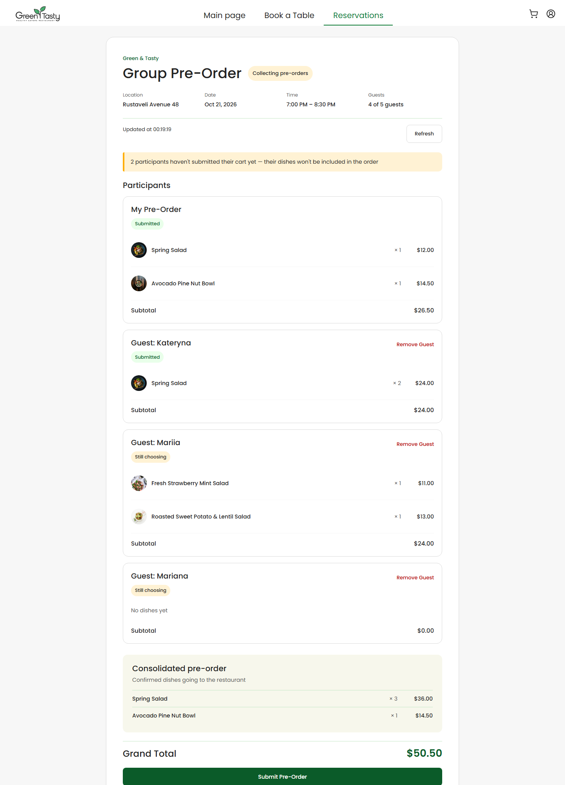
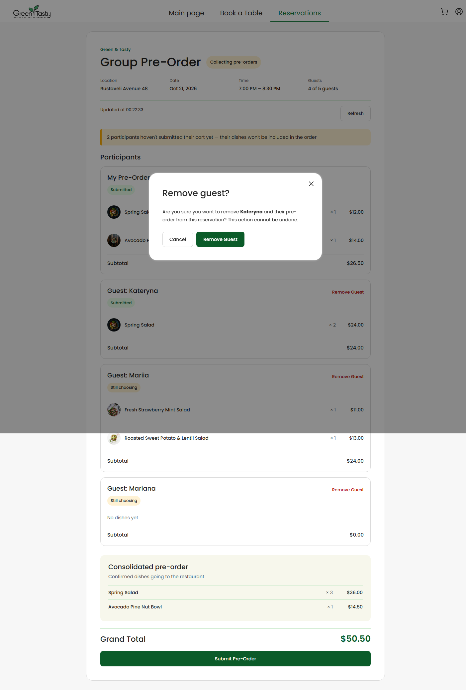
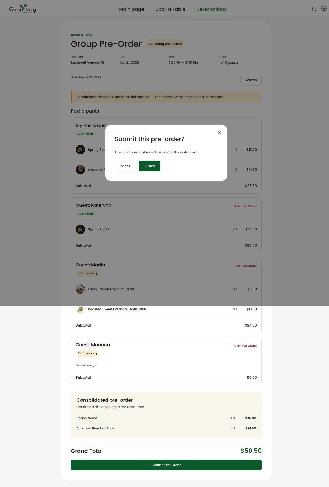
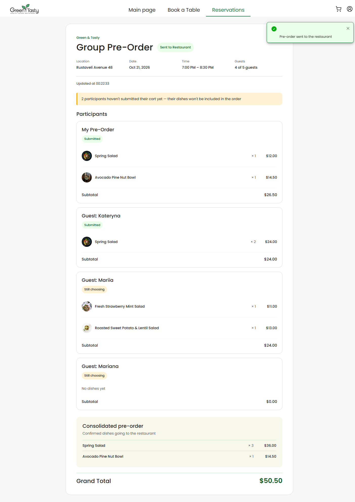

# Green & Tasty — Group Pre-Order

Рівень 3 марафону: екран групового передзамовлення для власника бронювання. Дані кошиків, статус групи та дії над гостями працюють через API.

## Що зроблено

- Показ учасників групи, статусів їхніх кошиків і консолідованого замовлення. До підсумку входять лише підтверджені кошики.
- Фонова синхронізація відкритої групи кожні 15 секунд і кнопка **Refresh** для негайного оновлення.
- Під час помилки фонового оновлення останні успішні дані залишаються на екрані; помилка відображається поруч із часом останнього оновлення.
- Підтвердження перед відправленням замовлення до ресторану; після успішного Submit група переходить у стан **Sent to Restaurant**, синхронізація зупиняється.
- Можливість видалити гостя з відкритої групи після підтвердження дії; список і суми оновлюються за відповіддю API.
- Стани завантаження, помилки та повторного завантаження.

## Скріншоти

Ці знімки зроблені в локальному браузері на демо-даних для перевірки вигляду екранів. Вони не є підтвердженням роботи з розгорнутим API.

  
Відкрита група: учасники, кошики, підсумок і Refresh

  
Підтвердження видалення гостя

  
Підтвердження відправлення передзамовлення

  
Група після успішного Submit

### Як відкрити демо-екран

1. Запустити застосунок командою `npm start`.
2. Відкрити `http://localhost:4200/reservations/demo-reservation/group-order?demo`.

Параметр `?demo` вмикає локального демо-користувача, а `demo-reservation` — локальні дані групового замовлення. Демо-мок доступний лише в development-режимі; для перевірки справжнього API потрібен розгорнутий бекенд і його URL у `src/environments/environment.development.ts`.

## Перевірка

Перевірки, виконані під час підготовки:

| Команда | Результат |
|---|---|
| `npm run test:hw` | Усі 67 тестів пройшли |
| `npx tsc -p tsconfig.app.json --noEmit` | Успішно |
| `npx tsc -p tsconfig.spec.json --noEmit` | Успішно |

Локальні тести та демо перевіряють код і стани інтерфейсу. Наскрізну перевірку проти розгорнутого API потрібно виконувати окремо з доступним stage бекенду.

## Використання AI

Так. AI-помічник у VS Code використовувався для аналізу проєкту, підготовки цього опису та пояснення помилки запиту під час розробки. Зміст README звірений із реалізацією, скріншотами та результатами автоматичних тестів і перевірки TypeScript.
