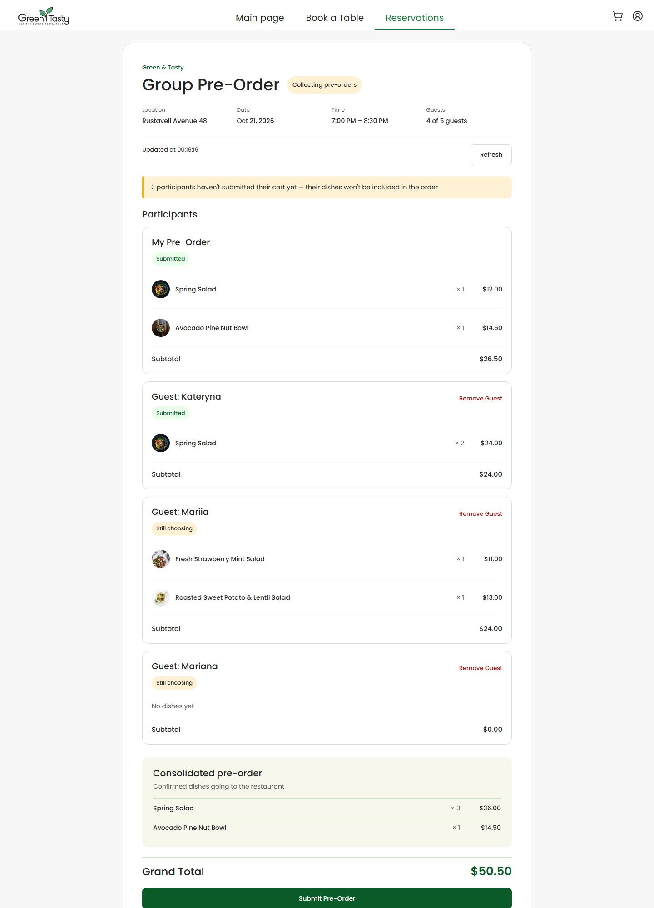
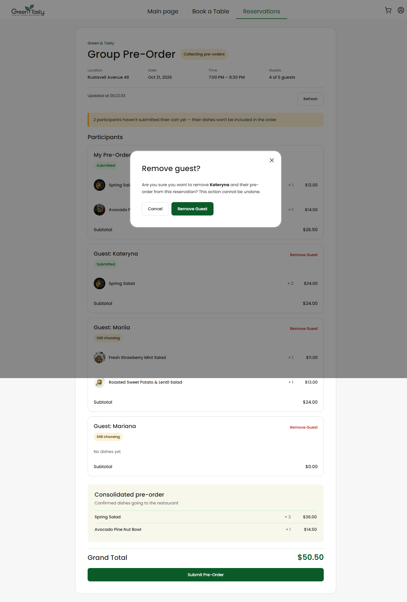
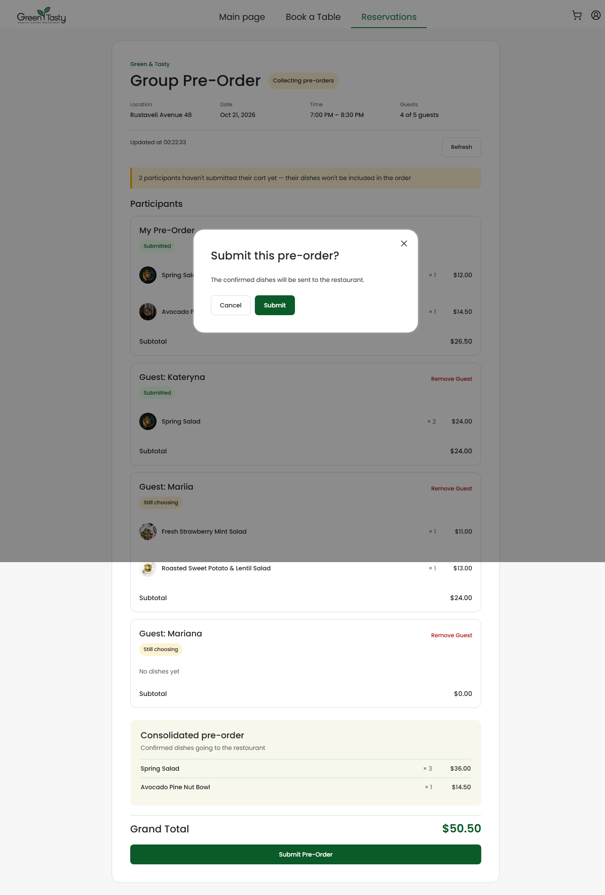
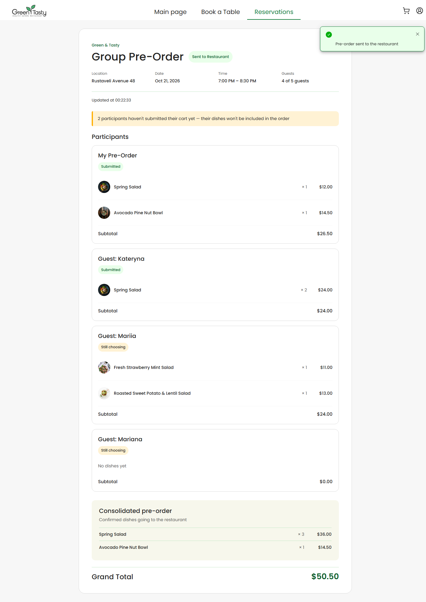

# Green & Tasty — Group Pre-Order

Рівень 3 марафону: екран групового передзамовлення для власника бронювання. Дані кошиків, статус групи та дії над гостями працюють через API.

## Що зроблено

- Показ учасників групи, статусів їхніх кошиків і консолідованого замовлення. До підсумку входять лише підтверджені кошики.
- Фонова синхронізація відкритої групи кожні 15 секунд і кнопка **Refresh** для негайного оновлення.
- Під час помилки фонового оновлення останні успішні дані залишаються на екрані; помилка відображається поруч із часом останнього оновлення.
- Підтвердження перед відправленням замовлення до ресторану; після успішного Submit група переходить у стан **Sent to Restaurant**, синхронізація зупиняється.
- Можливість видалити гостя з відкритої групи після підтвердження дії; список і суми оновлюються за відповіддю API.
- Стани завантаження, помилки та повторного завантаження.

## Скріншоти

Ці знімки зроблені в локальному браузері на демо-даних для перевірки вигляду екранів. Вони не є підтвердженням роботи з розгорнутим API.

<details>
  <summary>Відкрита група: учасники, кошики, підсумок і Refresh</summary>


</details>

<details>
  <summary>Підтвердження видалення гостя</summary>


</details>

<details>
  <summary>Підтвердження відправлення передзамовлення</summary>


</details>

<details>
  <summary>Група після успішного Submit</summary>


</details>

### Як відкрити демо-екран

1. Запустити застосунок командою `npm start`.
2. Відкрити `http://localhost:4200/reservations/demo-reservation/group-order?demo`.

Параметр `?demo` вмикає локального демо-користувача, а `demo-reservation` — локальні дані групового замовлення. Демо-мок доступний лише в development-режимі; для перевірки справжнього API потрібен розгорнутий бекенд і його URL у `src/environments/environment.development.ts`.

## Перевірка

Перевірки, виконані під час підготовки:

| Команда | Результат |
|---|---|
| `npm run test:hw` | Усі 70 тестів пройшли |
| `npx tsc -p tsconfig.app.json --noEmit` | Успішно |
| `npx tsc -p tsconfig.spec.json --noEmit` | Успішно |

Локальні тести та демо перевіряють код і стани інтерфейсу. Наскрізну перевірку проти розгорнутого API потрібно виконувати окремо з доступним stage бекенду.

## CI та результати ReportPortal

Звіт зі скриншотами: [docs/ReportPortal_1.docx](../../docs/ReportPortal_1.docx).

Workflow [tests.yml](../../.github/workflows/tests.yml) запускає `build-test` на self-hosted runner:

1. Отримує код через `actions/checkout`.
2. Встановлює Node.js 22 і налаштовує кеш npm.
3. Встановлює залежності командою `npm ci`.
4. Запускає lint; помилка цього кроку не зупиняє job (`continue-on-error`).
5. Запускає unit-тести в Chrome Headless; Karma створює `test-results/junit.xml`.
6. Надсилає JUnit-результати до ReportPortal. Цей крок має `if: always()`, тому запускається і після падіння тестів.
7. Збирає застосунок командою `npm run build`, якщо попередні обов'язкові кроки завершилися успішно.

Workflow запускається для змін у frontend на `main`, для pull request зі змінами frontend, за щоденним розкладом та вручну. Успішний lint сам по собі не підтверджує успішність job, а помилка unit-тестів не дозволяє перейти до build, хоча звіт надсилається.

### Що показують скриншоти у звіті

1. **Завантаження результатів:** ручний запуск `rp-upload.mjs` і підсумок 259 успішних, 46 невдалих та 0 пропущених тестів. Це вивід термінала, а не сторінка GitHub Actions.
2. **Історія запусків:** п'ять launch-ів `Frontend unit tests`; кожен містить 305 тестів, з них 259 passed і 46 failed. Опис launch-у посилається на GitHub Actions runs #12 і #13.
3. **Dashboard:** агрегат за п'ятьма launch-ами — 1 525 виконань, 1 295 passed, 230 failed, 0 skipped; усі 230 помилок позначено `To Investigate`.
4. **Перелік невдалих тестів:** назви тестів `GeneralInformationComponent`, згруповані під Chrome Headless 156 на Linux. Скриншот показує статуси `Failed` і `To Investigate`, але не відкритий лог чи класифікацію дефекту.

### Аналіз прикладу падіння

У доступному `test-results/junit.xml` для тесту `GeneralInformationComponent rejects the first name "Alice!"` записано:

```text
Error: <spyOnProperty> : result is not declared configurable
at general-user-info.component.spec.ts:84:5
```

У `beforeEach` тесту на цьому рядку `spyOnProperty` намагається підмінити getter `FileReader.prototype.result`. Браузер оголошує цей getter неконфігурованим, тому Jasmine завершує підготовку тесту помилкою до виконання перевірки імені. Це дефект тестового оточення/автоматизації, а не підтверджений дефект валідації профілю. Та сама помилка є у 32 випадках у доступному JUnit-файлі; решта падінь мають інші повідомлення і потребують окремого аналізу. У звіті ці помилки ще не класифіковані й лишаються `To Investigate`.

## Використання AI

Так. AI-помічник у VS Code використовувався для аналізу проєкту, підготовки цього опису та пояснення помилки запиту під час розробки. Зміст README звірений із реалізацією, скріншотами та результатами автоматичних тестів і перевірки TypeScript.
